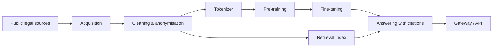

# lexpl — Polish legal language model (public overview)

> **Status: in training.** This repository is an overview only. Source code, model weights, training data, methods and configuration are proprietary to [Antillia Tech](https://antillia.tech) and are not published here.

## What it is

lexpl is a Polish language model for legal text, trained from scratch rather than fine-tuned from an existing foreign model. The goal is an assistant that answers questions about Polish law with verifiable references to the source text — and says so when it cannot find a reliable source.

## Why

- Legal answers are only useful if they can be checked. Every answer should point to the provision it relies on.
- Law changes over time. The question "what did this article say on a given date" matters as much as "what does it say now".
- Polish legal language is specific. A model built for it from the ground up can handle it more efficiently than a general model.

## How the system is organised

| Stage | What happens |
|---|---|
| Acquisition | Collecting publicly available legal texts from official sources, with a registry of sources and their licences |
| Cleaning | Text extraction, normalisation, deduplication, quality filtering |
| Privacy | Personal data detected and anonymised before training |
| Tokenizer | Own tokenizer built for Polish legal text |
| Pre-training | Decoder-only transformer trained from scratch on one consumer GPU |
| Retrieval | Search over legal provisions, aware of which version was in force on a given date |
| Answering | Answers grounded in retrieved provisions, with citations checked against the source |
| Serving | Gateway with streaming responses, queueing and rate limiting |

## In numbers

| | |
|---|---|
| Training corpus | 12.6 M documents, 25.1 B tokens — cleaned, deduplicated, anonymised |
| Own tokenizer | 1.30 tokens per Polish legal word; general models need 1.85–2.42× more tokens for the same text |
| Current model | 150 M parameters, trained from scratch on one RTX 3080 (10 GB) |
| Next model | ~1 B parameters, same hardware |
| Benchmark | 4 500 official Polish legal entrance-exam questions (bar, legal adviser, notary, bailiff) with answers and legal basis |
| Contamination check | 0 of 2 942 exam questions found in the training data |
| Built-in search | right article in the top 5 for 85.7 % of exam questions |

## Progress by release

Each release is the same 150 M base model with a better post-training recipe. What changed between releases is the result of many engineering iterations on data, search and training; the details stay private.

| Release | Exams, with search ¹ | Article + verbatim quote ² | Real tax questions ³ | Without Polish letters ⁴ | People's own questions ⁵ |
|---|---|---|---|---|---|
| Base (pre-trained only) | 57.2 % | – | – | – | – |
| R1 | 61.1 % | 93 / 100 | 2 / 200 | 56 / 100 | – |
| R2 (lexpl 0.15) | 61.3 % | 92 / 100 | 122 / 200 | 83 / 100 | 0 / 181 |
| R3 | **72.2 %** | 92 / 100 | 102 / 200 | 85 / 100 | 0 / 181 |
| R4 | 69.6 % | 90 / 100 | **124 / 200** | 81 / 100 | 6 / 181 |
| R5 | 70.2 % | **95 / 100** | 121 / 200 | **87 / 100** | 11 / 421 |
| **R6 (current)** | 71.0 % | 90 / 100 | 119 / 200 | 86 / 100 | **31 / 421** |
| R7 | *in progress — target: people's own questions* | | | | |

1. Official entrance exams, development split (1 350 of 4 500 questions; the rest stays untouched), 3 options: chance 33.3 %, pass mark 66.7 %. Reference point without any model — picking the option that shares the most words with the same retrieved articles — scores 69.3 %. The model alone, without search, scores ~48–52 %.
2. "What does art. X say / which article says …" — correct article and an exact quote of its text.
3. Real taxpayer questions from official tax interpretations, held out from fine-tuning: the right provision.
4. The same citation questions typed in lowercase without Polish letters.
5. Questions written the way people ask, about articles held out from training (181 questions until R4, 421 from R5).

## Current results (R6)

- **Entrance exams:** 71.0 % — above the pass mark (66.7 %) and the no-model reference (69.3 %). A general open model about 30× larger (4.7 B) scores 53.0 % on the same questions.
- **Professional exams** (statutory auditor, tax adviser): 45.0 % vs 53.3 % for the 4.7 B general model. The general model is stronger in finance and accounting; lexpl is stronger in tax law.
- **Weak spot:** people's own, colloquial questions — the right article for 31 of 421 (7 %). This is what R7 works on.

## Engineering practices

- Python 3.12, locked dependencies, CLI for every pipeline stage
- Static checks (linting, formatting, strict type checking) and automated tests: unit, integration, golden-file and property-based
- Continuous integration on every push
- Resumable, deterministic training runs with atomic checkpoints
- Defensive I/O: atomic writes, disk-space guards, path-traversal protection
- Parts of data processing implemented in Rust for throughput
- Polite data collection: respects `robots.txt` and rate limits
- Benchmark questions are removed from training data to avoid contamination
- The gateway listens only locally and is exposed through a tunnel; message contents are not logged

## What is not here

Model weights, code, datasets, architecture details, training methods and recipes. These stay private.

## Contact

[Antillia Tech](https://antillia.tech) · [LinkedIn](https://www.linkedin.com/in/antilliatechcto/)
