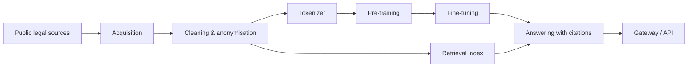

# lexpl — Polish legal language model (public overview)

> **Status: in training.** This repository is an overview only. Source code, model weights, training data, configuration and evaluation results are proprietary to [Antillia Tech](https://antillia.tech) and are not published here.

## What it is

lexpl is a Polish language model for legal text, trained from scratch rather than fine-tuned from an existing foreign model. The goal is an assistant that answers questions about Polish law with verifiable references to the source text — and says so when it cannot find a reliable source.

## Why

- Legal answers are only useful if they can be checked. Every answer should point to the provision it relies on.
- Law changes over time. The question "what did this article say on a given date" matters as much as "what does it say now".
- Polish legal language is specific. A model built for it from the ground up can handle it more efficiently than a general model.

## How the system is organised

| Stage | What happens |
|---|---|
| Acquisition | Collecting publicly available legal texts from official sources, with a registry of sources and their licences |
| Cleaning | Text extraction, normalisation, deduplication, quality filtering |
| Privacy | Personal data detected and anonymised before training |
| Tokenizer | Own tokenizer built for Polish legal text |
| Pre-training | Decoder-only transformer trained from scratch on a single consumer GPU |
| Retrieval | Search over legal provisions, aware of which version was in force on a given date |
| Answering | Answers grounded in retrieved provisions, with citations checked against the source |
| Serving | Gateway with streaming responses, queueing and rate limiting |

## Engineering practices

- Python 3.12, locked dependencies, CLI for every pipeline stage
- Static checks (linting, formatting, strict type checking) and automated tests: unit, integration, golden-file and property-based
- Continuous integration on every push
- Resumable, deterministic training runs with atomic checkpoints
- Defensive I/O: atomic writes, disk-space guards, path-traversal protection
- Parts of data processing implemented in Rust for throughput
- Polite data collection: respects `robots.txt` and rate limits
- Benchmark questions are removed from training data to avoid contamination
- The gateway listens only locally and is exposed through a tunnel; message contents are not logged

## What is not here

Model weights, code, datasets, architecture details, training recipes, metrics and evaluation results. These stay private.

## Contact

[Antillia Tech](https://antillia.tech) · [LinkedIn](https://www.linkedin.com/in/antilliatechcto/)
