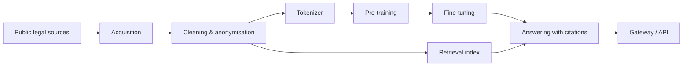

# lexpl — a Polish language model trained from scratch

**Most "Polish" language models are foreign models — Chinese, French or American — fine-tuned on Polish text. lexpl is not.** We pre-train our own model from zero: Polish data, our own tokenizer, our own weights. Nothing underneath it comes from someone else's model.

The first domain is Polish law and tax: lexpl learns to answer with a verbatim quote of the provision in force — and says so when it cannot find a reliable source.

> **Status: in training.** This repository is a public overview. Source code, model weights, training data, methods and configuration are proprietary to [Antillia Tech](https://antillia.tech).

## In numbers

| | |
|---|---|
| Training corpus | 12.6 M documents, 25 B tokens — cleaned, deduplicated, anonymised |
| Own tokenizer | 1.30 tokens per Polish legal word; general models need 1.85–2.42× more tokens for the same text |
| Current model | 150 M parameters, trained from scratch on one RTX 3080 (10 GB) |
| Next model | ~1 B parameters |
| Benchmark | 4 500 official Polish legal entrance-exam questions (bar, legal adviser, notary, bailiff) |
| Contamination check | 0 of 2 942 exam questions found in the training data |
| Built-in search | right article in the top 5 for 85.7 % of exam questions |

## Progress by release

Each release is the same 150 M base model with a better post-training recipe — the result of many engineering iterations on data, search and training.

| Release | Exams, with search ¹ | Article + verbatim quote ² | Real tax questions ³ | Without Polish letters ⁴ | People's own questions ⁵ |
|---|---|---|---|---|---|
| Base (pre-trained only) | 57.2 % | – | – | – | – |
| R1 | 61.1 % | 93 / 100 | 2 / 200 | 56 / 100 | – |
| R2 (lexpl 0.15) | 61.3 % | 92 / 100 | 122 / 200 | 83 / 100 | 0 / 181 |
| R3 | **72.2 %** | 92 / 100 | 102 / 200 | 85 / 100 | 0 / 181 |
| R4 | 69.6 % | 90 / 100 | **124 / 200** | 81 / 100 | 6 / 181 |
| R5 | 70.2 % | **95 / 100** | 121 / 200 | **87 / 100** | 11 / 421 |
| **R6 (current)** | **71.0 %** | 90 / 100 | 119 / 200 | 86 / 100 | **31 / 421** |
| R7 | *in progress — people's own questions* | | | | |

1. Official entrance exams, development split (1 350 of 4 500 questions; the rest stays untouched). Pass mark: 66.7 %.
2. "What does art. X say / which article says …" — correct article and an exact quote of its text.
3. Real taxpayer questions from official tax interpretations, held out from training: the right provision.
4. The same citation questions typed in lowercase without Polish letters.
5. Questions written the way people ask, about articles held out from training (181 questions until R4, 421 from R5).

**Current results (R6):** 71.0 % on the entrance exams — above the pass mark (66.7 %). A ready-made open general model about 30× larger scores 53.0 % on the same questions. Next target: people's own, colloquial questions.

## Where we are going

1. **R7** — understanding how people actually ask.
2. **lexpl 1.0** — ~1 B parameters, the same recipe, trained on our own hardware.
3. **Scale up** — with funding: larger models, more domains, more countries' law using the same recipe.
4. **Long term** — a fully Polish foundation model, growing towards ~100 B parameters. Trained from scratch, not borrowed.

## What we plan to build on it

We do not plan another chatbot that "talks nicely". We plan narrow AI tools for real work, with our own model inside:

- **Legal and tax assistant** — answers with verifiable citations of the law in force.
- **Documents** — reading, extracting, filling in and sorting Polish documents for offices, accounting firms and law firms.
- **Agents** — automating routine work inside the client's own software.

Why it matters for a client:

- **Made for Polish** — Polish language and Polish law are the core of the model, not an add-on.
- **Cheaper to run** — a small specialised model instead of paying per query to a large general one.
- **Data stays with the client** — the model can run locally; nothing has to leave the company.
- **Tuned per client** — the model is licensed, and each client can get a version polished for their task.

## For investors and partners

The recipe works and the first model is baking. What limits us now is compute and time, not ideas. Capital goes into GPUs, data and the team — and the tools built on lexpl are a business for our partners too, not only for us.

**We are open to investors and partners.** Contact: [antillia.tech](https://antillia.tech) · [LinkedIn (CTO)](https://www.linkedin.com/in/antilliatechcto/) · [LinkedIn (CEO)](https://www.linkedin.com/in/ceo-mark-tamila-noctalis/)

## How the system is organised

| Stage | What happens |
|---|---|
| Acquisition | Collecting publicly available legal texts from official sources, with a registry of sources and their licences |
| Cleaning | Text extraction, normalisation, deduplication, quality filtering |
| Privacy | Personal data detected and anonymised before training |
| Tokenizer | Own tokenizer built for Polish legal text |
| Pre-training | Decoder-only transformer trained from scratch on one consumer GPU |
| Retrieval | Search over legal provisions, aware of which version was in force on a given date |
| Answering | Answers grounded in retrieved provisions, with citations checked against the source |
| Serving | Gateway with streaming responses, queueing and rate limiting |

## Engineering practices

- Python 3.12, locked dependencies, CLI for every pipeline stage
- Static checks (linting, formatting, strict type checking) and automated tests: unit, integration, golden-file and property-based
- Continuous integration on every push
- Resumable, deterministic training runs with atomic checkpoints
- Defensive I/O: atomic writes, disk-space guards, path-traversal protection
- Parts of data processing implemented in Rust for throughput
- Polite data collection: respects `robots.txt` and rate limits
- Benchmark questions are removed from training data to avoid contamination
- The gateway listens only locally and is exposed through a tunnel; message contents are not logged

## What is not here

Model weights, code, datasets, architecture details, training methods and recipes. These stay private.
